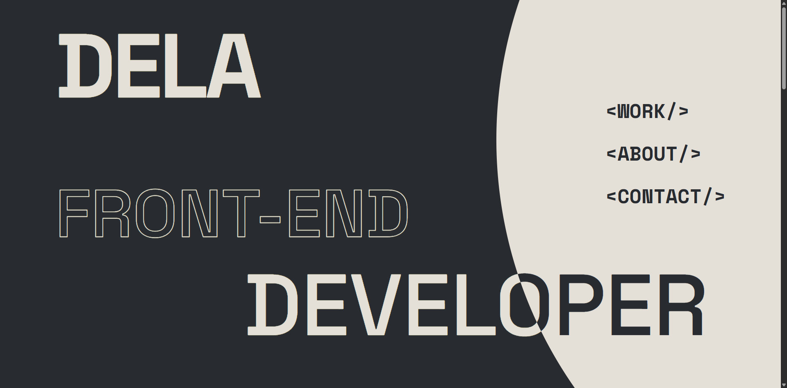

# Responsive Grid Portfolio

A responsive single-page developer portfolio combining editorial
typography, architectural geometry and modern front-end development.

Developed as part of the Frontend Development Internship at
Appverse Technologies.

## Live Demo

[View Live Portfolio](https://single-page-portfolio-nu.vercel.app/)

## Project Preview



## Technologies

- React
- Vite
- JavaScript ES6+
- Tailwind CSS
- CSS3
- React Icons
- Vercel

## Features

- Mobile-first responsive layout
- Named CSS Grid areas
- Responsive project card grid
- Flexbox navigation and card actions
- CSS container queries
- Reusable React components
- Custom design tokens
- Editorial typography and outlined text
- Geometric layouts using CSS clip-path
- Interactive case study dialogs
- JavaScript-style developer profile
- Smooth section navigation
- Keyboard-friendly interactions
- Email contact and CV download
- Reduced-motion support

## Portfolio Sections

### Hero

An editorial introduction featuring oversized typography,
a geometric circle and contrasting text colours.

The layout adapts to different screen sizes using
CSS Grid and responsive breakpoints.

### Selected Work

A responsive grid showcasing four development projects:

- **SetCoffee** — Next.js e-commerce website.
- **WebSol** — Responsive digital agency landing page.
- **VoyaVista** — Full-stack UK travel application
  (in development).
- **TaskFlow** — Vanilla JavaScript task management application.

Each project includes a preview image, technologies,
project links and a concise technical case study.

### About

An architecture-inspired section featuring staggered
typography, a personal introduction and a JavaScript-style
developer profile.

The section highlights my technical skills, interest in
problem-solving and passion for user experience.

### Contact

A geometric footer with a diagonal colour split,
staircase navigation and inverted hover effects.

Includes GitHub, LinkedIn, email, CV download
and back-to-top navigation.

## Responsive Design

The project follows a mobile-first development approach.

### Named Grid Areas

Named grid areas are used to organise the hero,
project cards, About section and footer.

### Responsive Card Grid

The project grid displays one column on mobile
and two columns from 768px.

### Flexbox

Flexbox is used for navigation, technology tags,
card actions and footer alignment.

### Media Queries

Responsive breakpoints adapt the layout, typography
and spacing to different viewport sizes.

### Container Queries

Individual project cards respond to their available
container width rather than relying only on the
viewport width.

## Installation

Install the project dependencies:

```bash
npm install
```

Start the development server:

```bash
npm run dev
```

Create a production build:

```bash
npm run build
```

Preview the production build:

```bash
npm run preview
```

## Learning Outcomes

Through this project, I strengthened my understanding of:

- CSS Grid and named grid areas
- Flexbox alignment
- Mobile-first responsive design
- CSS container queries
- CSS clip-path and geometric layouts
- Reusable React components
- Accessible interface interactions
- Native HTML dialog elements
- Translating design concepts into functional interfaces

## Author

**Delaram Farzad**

Front-end Developer

- [GitHub](https://github.com/delaramfarzad9)
- [LinkedIn](https://www.linkedin.com/in/delaram-farzad)

## Internship Information

- **Organisation:** Appverse Technologies
- **Programme:** Frontend Development Internship
- **Project:** Responsive Grid Portfolio
- **Registration Number:** OCT26-FE26-34
